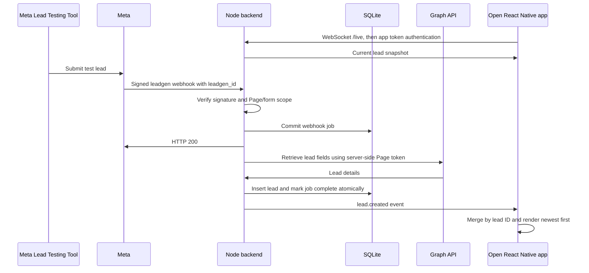

# Architecture

The Meta webhook identifies the new lead. A separate Graph API request retrieves the submitted fields. Meta credentials never reach the mobile client.

The inbox table is the durable queue. Storing a job before returning HTTP 200 avoids losing notifications when the backend restarts. The worker runs serially and only broadcasts after the lead transaction commits. Both jobs and leads have unique Meta lead IDs, so repeated webhooks do not create repeated rows.

Temporary Graph errors use exponential backoff, capped at one minute and eight attempts. Permanent errors remain failed until explicitly retried. A request that cannot be persisted returns an error, allowing Meta to retry rather than acknowledging lost work.

WebSocket authentication happens in the first message so the app token is not placed in URLs or access logs. The server sends a synchronous snapshot after authentication and then incremental events on the same connection. This ordering prevents a snapshot/live-update race. On reconnect the app obtains another snapshot, covering leads that arrived while disconnected. Native foreground changes trigger a fresh connection.

Android supplies a default WebSocket Origin based on the backend address. WebSocket access therefore relies on the explicit app token, not a browser-only Origin allowlist; cookie authentication is not used. HTTP browser requests allow only the configured preview origin.

HTTP status polling every 15 seconds updates pending/failed counts; it does not drive live lead delivery. A heartbeat removes dead sockets. Timed authentication and a small client-message limit constrain unauthenticated connections.

## HTTP and live interfaces

| Interface | Access | Behavior |
| --- | --- | --- |
| `GET /health` | Public | Liveness only; no lead details |
| `GET /webhooks/meta` | Verify token | Meta challenge response |
| `POST /webhooks/meta` | Meta HMAC signature | Persist scoped leadgen notifications |
| `GET /api/status` | Bearer app token | Mode, lead count, pending and failed jobs |
| `GET /api/leads` | Bearer app token | Latest 200 stored leads |
| `POST /api/jobs/retry` | Bearer app token | Requeue failed jobs |
| `POST /api/demo/leads` | Bearer app token, demo mode only | Create an explicitly synthetic lead |
| `WS /live` | First-message app token | Snapshot followed by lead events |

Production traffic should use HTTPS and WSS. The verify token, Meta app secret, Page token, and app access token have separate purposes and must not be confused.

## What the tests establish

The integration tests send signed HTTP notifications to a real local test server and observe a real WebSocket client. Graph retrieval is stubbed for these pipeline tests. Separate retrieval tests verify request authentication, field mapping, and error classification with controlled HTTP responses. These tests do not prove permissions on a real Meta account or rendering on a native device.
